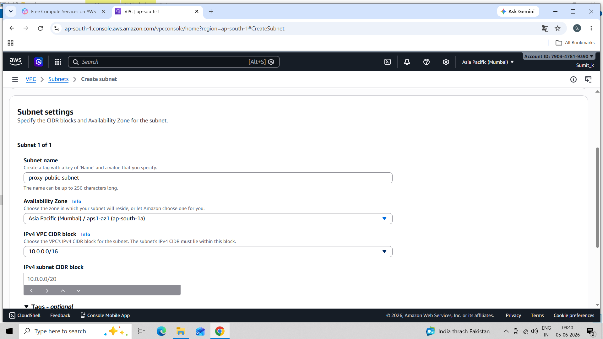
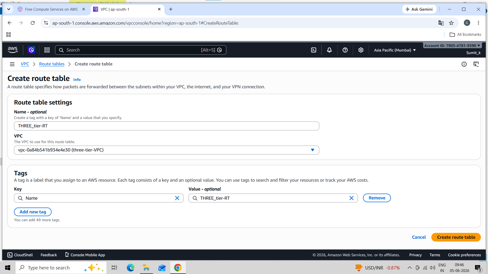
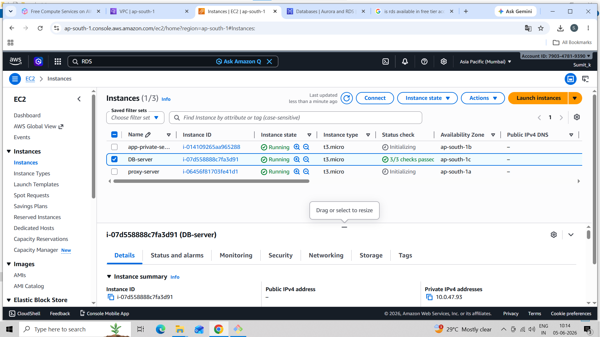
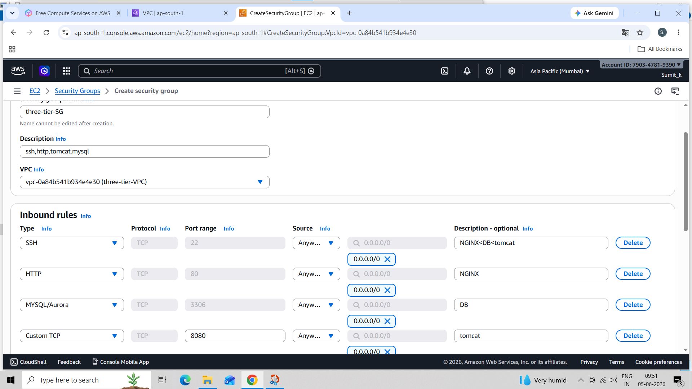
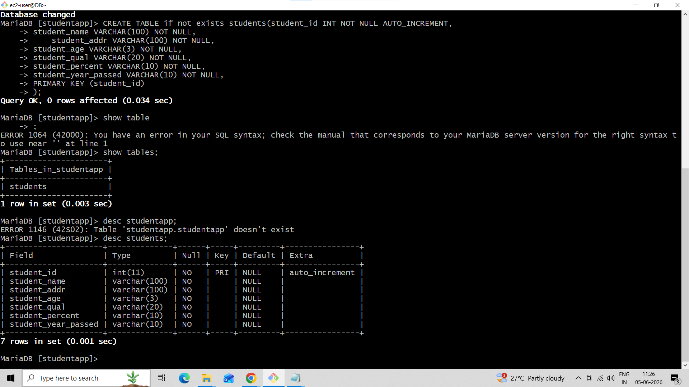
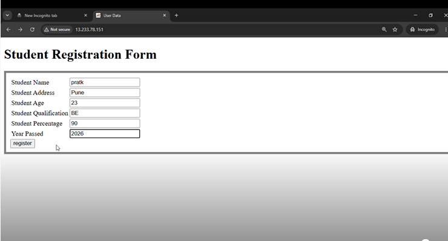
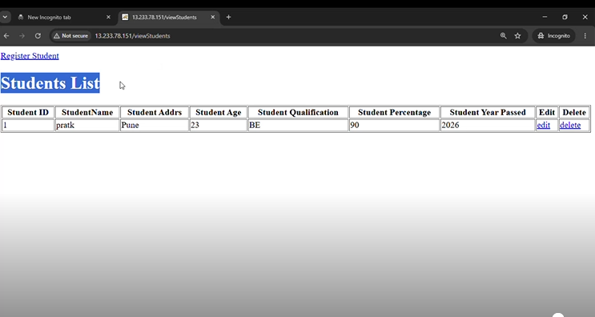

#  The AWS 3-Tier Architecture

A hands-on AWS infrastructure project focused on designing a secure, scalable, and maintainable application platform using a three-tier architecture: **Web, Application, and Database**.

This project demonstrates network isolation, controlled tier-to-tier communication, and AWS infrastructure design using VPCs, subnets, EC2, routing, security groups, and managed database patterns.


## Project Overview

Traditional single-server deployments can create performance bottlenecks, increase downtime risk, and make maintenance harder. They can also expose databases to unnecessary network risk.

This project uses a three-tier design to separate responsibilities:

1. **Web tier:** Receives user traffic. The proposed design uses Nginx in a public subnet.
2. **Application tier:** Runs application logic on an application server, such as Tomcat, in a private subnet.
3. **Database tier:** Stores application data in a private network location, preferably using Amazon RDS for managed database operations.

Each tier communicates through controlled network paths. The database is not intended to be directly accessible from the public internet.


## Objectives

- **Secure network boundaries:** Use a VPC with public and private subnets.
- **Separate application tiers:** Keep web, application, and database responsibilities distinct.
- **Control communication:** Use route tables and security groups to allow only required traffic.
- **Support reliability:** Establish a foundation for monitoring, backups, and future managed-service enhancements.

## Architecture


### Network layout

```text
AWS Region
└── VPC
    ├── Public Subnet
    │   └── Web Server (Nginx / EC2)
    ├── Private Application Subnet
    │   └── Application Server (Tomcat / EC2)
    ├── Private Database Subnet
    │   └── Database (MariaDB or Amazon RDS)
    ├── Internet Gateway (for public-subnet internet routing)
    ├── NAT Gateway (for outbound internet access from private subnets, if required)
    ├── Route Tables
    └── Security Groups / optional Network ACLs
```

The exact placement of the NAT Gateway, number of Availability Zones, and whether the database is self-managed or Amazon RDS depend on the implementation.

## AWS Services and Components

| AWS service / component | Purpose |
|---|---|
| Amazon VPC | Provides an isolated virtual network for the architecture. |
| Public and private subnets | Separate internet-facing resources from application and database resources. |
| Amazon EC2 | Hosts web and application components. |
| Nginx | Acts as the web tier in the proposed topology. |
| Apache Tomcat | Example application server for the application tier. |
| MariaDB / Amazon RDS | Provides the database tier. Amazon RDS is the recommended managed option in the project design. |
| Internet Gateway (IGW) | Enables internet routing for resources in public subnets, when routes and security rules permit it. |
| NAT Gateway | Allows private-subnet resources to initiate outbound internet connections without accepting unsolicited inbound internet connections. |
| Route Tables | Define network traffic routes between subnets and network gateways. |
| Security Groups | Restrict inbound and outbound traffic at the resource level. |
| Network ACLs | Optional subnet-level traffic filtering. |


## Implementation Steps

The following steps follow the implementation approach described in the project presentation.

### 1. Create the VPC and subnets
- Plan the VPC CIDR range.
- Create a public subnet and private subnets for the application and database tiers.
- Consider using multiple Availability Zones for improved resilience.

### 2. Configure Internet Gateway and NAT Gateway
- Attach an Internet Gateway to the VPC.
- Configure the public subnet's route table for internet routing.
- Create a NAT Gateway in a public subnet if private instances require outbound internet access.

### 3. Configure route tables
- Associate route tables with the relevant subnets.
- Add only the routes needed for the intended traffic.
- Apply Network ACL rules if subnet-level filtering is required.

### 4. Deploy the web and application servers
- Launch the web server, such as Nginx, in the public subnet.
- Launch the application server, such as Tomcat, in a private subnet.
- Harden the instances and restrict administrative access.

### 5. Configure the database tier
- Use Amazon RDS where possible for managed backups, patching, and options such as Multi-AZ.
- If using a self-managed MariaDB server, keep it in a private subnet and restrict database access to the application tier.

### 6. Configure security groups
Use least-privilege rules appropriate to your actual application. A typical pattern is:

### 7. Deploy and verify the application
- Deploy the application to the application tier.
- Confirm the intended web-to-application and application-to-database communication paths.
- Check server logs and AWS network/security configuration when troubleshooting.
- Verify that the database is not directly reachable from the public internet.

## Security and Networking

Security practices emphasized in this design:

- Keep application and database tiers in private subnets where appropriate.
- Allow inbound traffic only on required ports and from trusted sources.
- Use security-group references between tiers where possible.
- Restrict SSH access to trusted IPs or use AWS Systems Manager Session Manager when configured.
- Store credentials outside source code and never commit secrets to GitHub.
- Use encryption, backups, monitoring, and logging appropriate to the application.
- Review route tables and security rules together; a route alone does not grant access if security controls block the traffic.

## Benefits

- **Security:** Network isolation and least-privilege rules reduce the attack surface.
- **Scalability:** Web and application tiers can be scaled independently as the design evolves.
- **Reliability:** Multi-AZ database deployment, health checks, and automated recovery are potential enhancements.
- **Maintainability:** Clear separation of tiers simplifies updates and troubleshooting.

## Screenshots


### 1. VPC and Subnets

Shows the VPC and the public/private subnet layout.



### 2. Route Tables

Shows the routes associated with the relevant subnets. Hide sensitive information before uploading.



### 3. EC2 Instances

Shows the web and application instances used in the project.



### 4. Security Groups

Shows the restricted traffic rules between tiers. Make sure the screenshot does not expose sensitive details.



### 5. Database Configuration

Use the screenshot that matches your implementation: Amazon RDS configuration or your self-managed database server.



### 6. Application Test

Shows the application working or a successful connectivity test. Remove public IPs, credentials, tokens, and other details you do not want to disclose.





## Future Enhancements

The project presentation identifies these as possible next steps toward a more production-ready design:

- Add an Application Load Balancer (ALB) for traffic distribution, TLS termination, and health checks.
- Add Auto Scaling Groups for the web and application tiers.
- Use Amazon RDS with Multi-AZ, automated backups, and read replicas where appropriate.
- Integrate Amazon CloudWatch metrics, logs, and alarms.
- Implement CI/CD using AWS CodePipeline/CodeDeploy or an external CI/CD tool.
- Plan disaster recovery with cross-Region snapshots and documented recovery procedures.
- Review instance sizing and use cost-optimization options where suitable.

These are roadmap items unless you have already implemented them.

## Key Learnings

- Designing a VPC and separating resources into public and private subnets.
- Understanding traffic flow through route tables, an Internet Gateway, and a NAT Gateway.
- Applying least-privilege security-group rules between application tiers.
- Separating web, application, and database responsibilities.
- Planning for scalability, monitoring, backups, and resilience on AWS.

## Author

**Sumit Kamble**  
Cloud & DevOps

- GitHub: [sumitk-Cloud](https://github.com/sumitk-Cloud/)
- LinkedIn: [Sumit Kamble](https://www.linkedin.com/in/sumit-kamble-a6a3b540/)

---

If you found this project interesting, feel free to connect with me on LinkedIn and explore my other Cloud & DevOps projects on GitHub.
